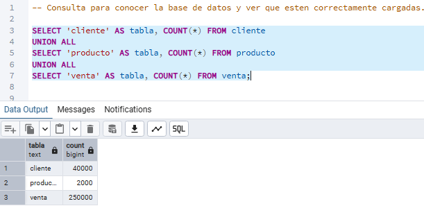
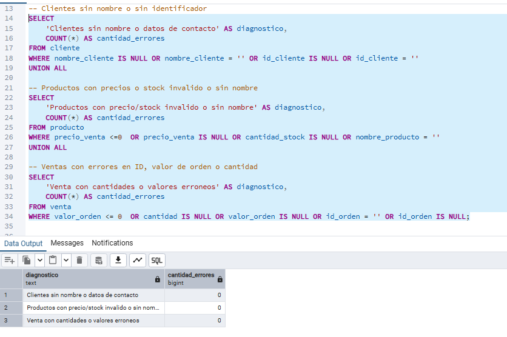
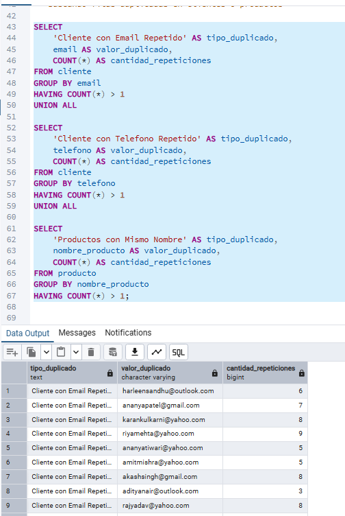
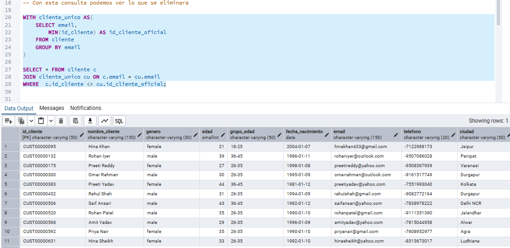
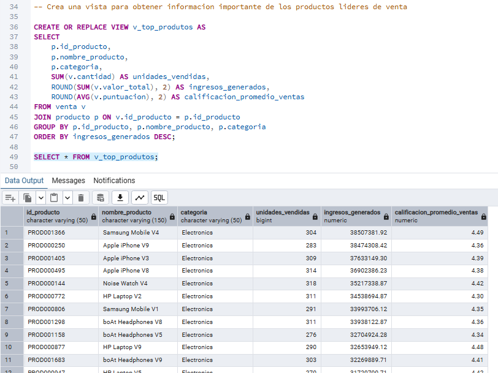
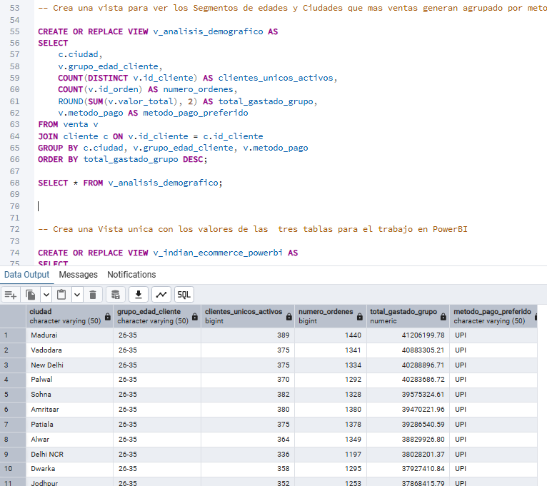
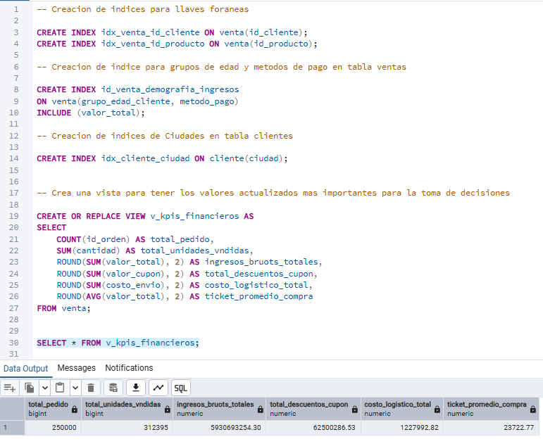
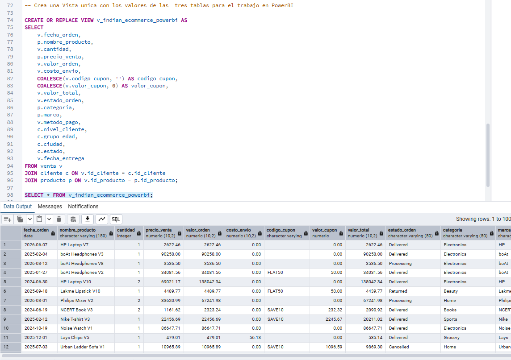

# Indian_ecommerce
Flujo de Ingenieria de Análisis de Datos en PostgreSQL para un eComemerce (250k+ registros). Con auditoria de calidad, limpieza con CTEs, optimización con índices y vistas analiticas para PowerBI

--------------------------------------------------------------------------------------------------
🛒 Análisis de Datos e Ingeniería SQL: Indian E-Commerce

Este proyecto desarrolla un flujo completo de base de datos en PostgreSQL para auditar, limpiar, optimizar y analizar el rendimiento de una plataforma de comercio electrónico con más de 250,000 registros de ventas. El objetivo principal es transformar datos brutos en una estructura optimizada y lista para conectar a herramientas de BI (como Power BI). 

--------------------------------------------------------------------------------------------------
📊 Arquitectura y Modelado de Datos

El diseño de la base de datos se compone de tres entidades principales con integridad referencial estricta: 

* cliente: Datos demográficos y de contacto de los usuarios (40,000 registros). 

* producto: Catálogo de productos, stocks, precios y puntuaciones (2,000 registros). 

* venta: Transacciones históricas detalladas con métricas financieras (250,000 registros). 

--------------------------------------------------------------------------------------------------
🔍 Etapas del Proyecto

1. Auditoría de Calidad de los Datos (Data Quality)

Antes de realizar análisis, ejecuté scripts de diagnóstico para identificar valores nulos, registros inválidos y duplicados críticos en el sistema. 

Se validó que no existieran inconsistencias en precios negativos, stocks nulos o IDs vacíos. 

Se detectaron múltiples registros de clientes con el mismo correo electrónico pero diferentes identificadores (id_cliente). 

2. Limpieza y Unificación de Registros (Deduplicación)

Para solucionar el problema de clientes duplicados con correos idénticos, apliqué una estrategia avanzada utilizando CTEs (Common Table Expressions): 

Identificación: Seleccionar el id_cliente más antiguo (mínimo) como el ID oficial para cada correo. 

Actualización: Redirigir el histórico de compras en la tabla venta hacia el nuevo ID unificado. 

Eliminación: Borrar los perfiles duplicados excedentes de la tabla cliente. 

3. Vistas Analíticas para Toma de Decisiones

Creé vistas (VIEW) específicas para responder a necesidades clave del negocio sin saturar la memoria: 

v_top_produtos: Identifica los productos líderes generadores de ingresos y unidades más vendidas. 

v_analisis_demografico: Agrupa el comportamiento de compra por ciudades y rangos de edad. 

v_kpis_financieros: Consolida métricas macro del negocio (Ticket promedio, volumen de pedidos, ingresos brutos y costos logísticos). 

v_indian_ecommerce_powerbi: Vista única desnormalizada que une el histórico transaccional aplicando tratamientos de nulos (COALESCE) lista para su explotación en tableros interactivos. 

4. Optimización de Consultas (Performance)

Dado el volumen de la tabla de ventas (250K filas), implementé índices estratégicos para acelerar los tiempos de respuesta en juntas y filtrados repetitivos: 

Índices B-Tree en Llaves Foráneas (id_cliente, id_producto). 

Índice compuesto e inclusivo para acelerar el análisis demográfico y financiero (grupo_edad_cliente, metodo_pago e INCLUDE(valor_total)). 

--------------------------------------------------------------------------------------------------
🛠️ Tecnologías Utilizadas

Motor de Base de Datos: PostgreSQL 18 

Interfaz de Desarrollo: pgAdmin 4 

Lenguaje: SQL (DDL, DML, Funciones de Agregación, CTEs)
